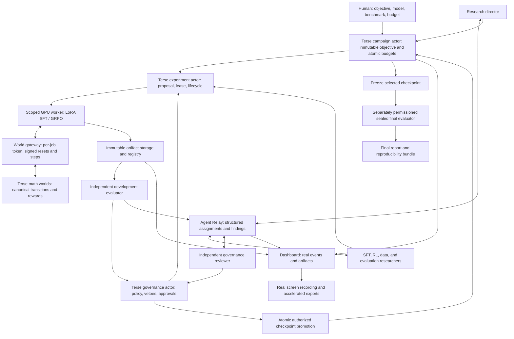

# Forge architecture

The system separates research decisions, authoritative state, compute, and independent
verification. The training core, durable actors and Relay dispatch to the worker are
implemented and tested locally, including deterministic evidence-driven experiment
selection, evidence-bound checkpoint governance and GRPO driven by world transitions
(the gate verified on an offline fixture; real Qwen campaigns found no improvement), and a
recorded research dashboard. This is the target architecture; separately hosted
evaluation remains a future integration.

## Directory and runtime boundaries

| Boundary | Location | Responsibility |
| --- | --- | --- |
| Training worker | `services/training-core/` | Implemented Python package; pinned models/data, bounded SFT LoRA and world-rewarded GRPO (pinned TRL), development diagnostics, rollout and lineage artifacts, real metrics |
| Research orchestration | `services/orchestrator/` | Implemented Relay transport, durable dispatch/reconciliation, worker adapter, world gateway with journal verification and deterministic evidence-driven director; model-backed proposals optional/planned |
| Authoritative state | `packages/terse-actors/` | Implemented Terse campaign, experiment, governance, math-world, registry, workflow-outbox and research-ledger actors; [integration contract](actor-contract.md) |
| Common contracts | `packages/contracts/` (planned) | Versioned actor/message/event schemas; consume worker-generated JSON Schema |
| Independent evaluation | `services/orchestrator/src/governance.ts`; `services/evaluator/` (planned) | Implemented: byte-level artifact verification, held-out regression suite, evidence-bound governance decisions. Planned: established benchmark harness and protected final evaluation |
| Research interface | repo root Next app (`app/`, `components/`, `services/api.py`) | Implemented loopback command center; see [command-center.md](command-center.md). The earlier `apps/web` dashboard (retired, recoverable at `6ab37db`) rendered from stored files and exported actor snapshots: research graph, budgets, experiments, training metrics, world transitions, governance, before/after examples, agent messages, recording state, downloads |
| Capture/export | `scripts/capture.py`, `scripts/render-video.py` | Implemented UTC-stamped frame capture with 100x/120x exports. The retired `apps/web` recorder (at `6ab37db`) implemented headless capture of the live view during a campaign, real-time VP8 source and 100x/120x FFmpeg exports, decoded frame-count verification, recording manifests; a failed preflight blocks the campaign |

## Agent synchronization

Use durable records for work and Relay for communication. Every assignment/proposal/
result carries campaign ID, experiment ID, message ID, causation ID, schema version,
and artifact references. Persist a state transition and its dispatch intent together;
send/retry from an outbox, acknowledge receipt, and reconcile against authoritative
experiment status. A sent message does not prove a job started or finished.

The director chooses proposals using development evidence and declared stopping
rules, and records diagnoses, hypotheses, decisions and rejected alternatives in the
research ledger, which verifies cited evidence against actor state (Phase 4). Workers
accept immutable, validated specs only after proposal approval and an atomic compute
reservation. Worker leases use a generation/fencing token so a
stale worker cannot complete or charge a superseded attempt. Completion is idempotent.
Strategy changes create new experiments rather than mutating a running job.

Phase 2 implements signed role-scoped commands, durable receipts and events, and
authenticated reservation grants. Phase 3 adds the workflow outbox, Relay delivery
with reconciliation, a preflight gate on worker leases, and actual worker execution. Campaign RPC reads experiment, registry and governance
state; those actors never call back into campaigns. Promotion uses immutable
terminal records to avoid cross-actor evidence changing during its validation.

Reserve money in integer micro-USD to avoid floating-point accounting. Reservation,
release/finalization, concurrency caps, and official checkpoint promotion must serialize
through the campaign authority. Provider spending limits remain an external backstop.
Do not make the Python worker an alternative budget or promotion authority.

## Independence and evidence

Research identities cannot modify objectives, governance policy or approval records,
read final answers, replace evaluation binaries, or create official promotions.
Reviewers and the final evaluator use separate credentials. Deterministic authorization
checks enforce critical gates; LLM reviewers supplement them. Checksums establish
artifact identity, while separately trusted records/signatures establish authority.

Promotion requires a complete artifact manifest, exact checkpoint identity, reproducible
development evaluation, required regression checks, provenance, and independent
approval tied to that hash. Invalid candidates remain visible with rejection evidence.
Freeze the candidate using development evidence before the separately authorized final
benchmark. Never feed final scores back into checkpoint selection.

## Recovery and observability

Every significant action produces a correlated event with a timestamp. The dashboard
reads persisted artifacts/events; it must not manufacture metrics or agent activity.
Checkpoint files and datasets live outside actor state. Recovery reconciles worker
leases, object-store completion, actor status, reserved compute, and message acks.
Terse durability alone does not resume GPU optimization; training checkpoint/resume
support needs its own tested implementation.

Test completion before subscription, partial artifact upload, duplicate result,
review before/after artifact registration, concurrent reservations, actor restart,
Relay reconnect, expired worker lease, failed recording, and budget exhaustion.
Surface failures and preserve evidence. A completed worker run is an unreviewed
candidate, never an automatically approved model improvement.
